<p align="center">
  <a href="https://make.pictures">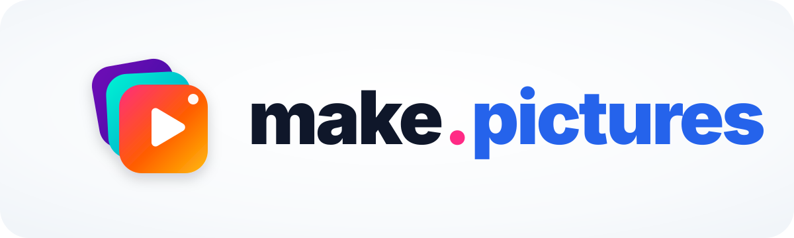</a>
</p>

<p align="center">
  <a href="https://www.npmjs.com/package/create-make-pictures"></a>
  
  
  <a href="./LICENSE"></a>
</p>

<h3 align="center">Create animations by directing your AI agent — and fine-tune every shot visually.</h3>

<p align="center">
  <a href="https://make.pictures">🌐 make.pictures</a> •
  <a href="https://www.youtube.com/@makepicturestv">📺 YouTube (EN)</a> •
  <a href="https://www.youtube.com/@makepicturespl">📺 YouTube (PL)</a> •
  <a href="./README.pl.md">🇵🇱 Polska wersja</a>
</p>

---

## ⚡ Start with one prompt

`1. Paste into Antigravity or Claude Code` → `2. Describe your idea & pick a style` → `3. Preview & export MP4 in Studio Web`

```text
Set up make.pictures video studio for me: run `npx -y @make-pictures/cli@latest onboard --lang=en` and follow every step until Studio Web is running.
```

---

## 🖥️ Studio Web & 🎨 Style Lab (`v2.2.0`)

<p align="center">
  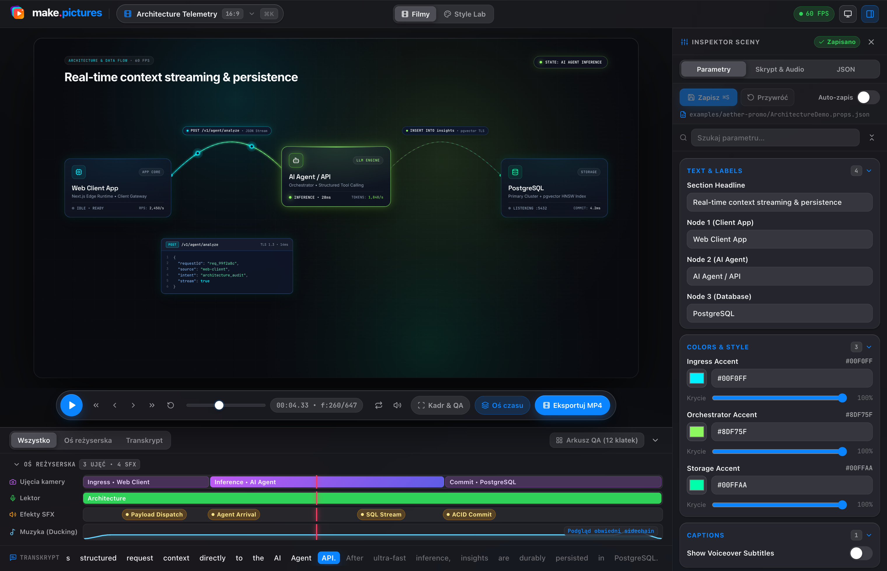
  <br />
  <sub><strong>Studio Web</strong> (<code>127.0.0.1:3000</code>) — live preview, camera/voice/SFX/music timeline, word-by-word transcript, 3-tab Inspector (<code>⌘I</code>) &amp; one-click MP4 export.</sub>
</p>

<p align="center">
  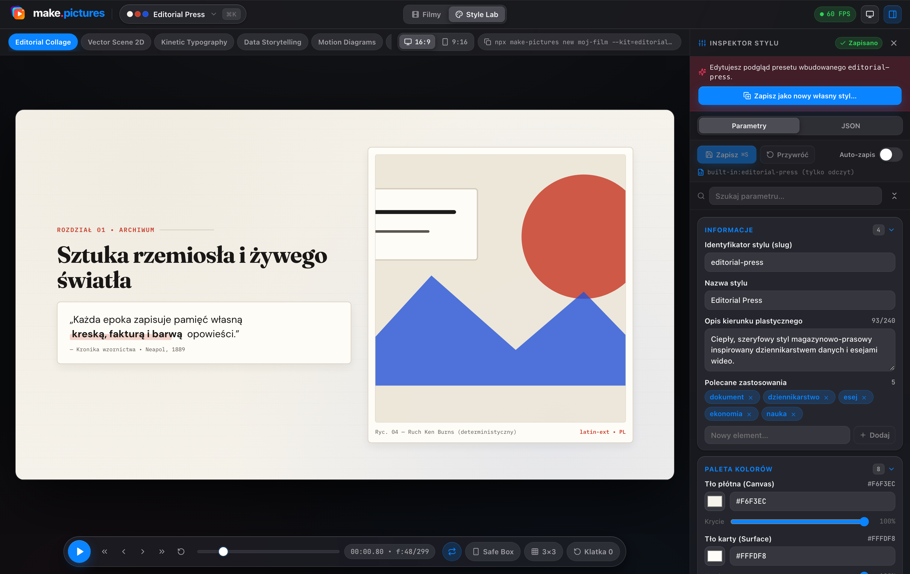
  <br />
  <sub><strong>🎨 Style Lab</strong> (<code>?view=styles</code>) — switch between 7 built-in art direction styles or fork your own brand preset in real time.</sub>
</p>

---

## 🎬 What you can make in minutes

| Product &amp; SaaS Demos (`product-frames`) | System &amp; Data Flows (`motion-diagrams-2d`) |
| :---: | :---: |
| 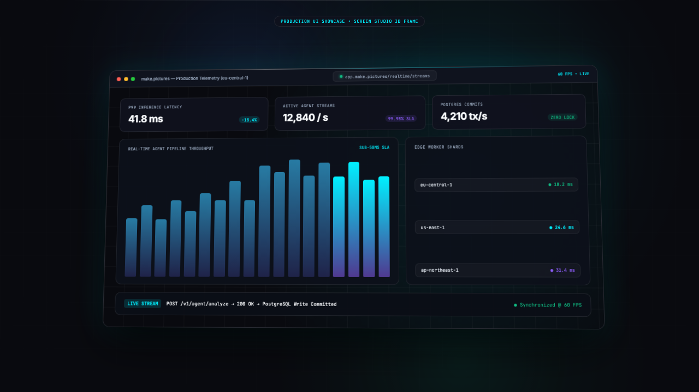 | 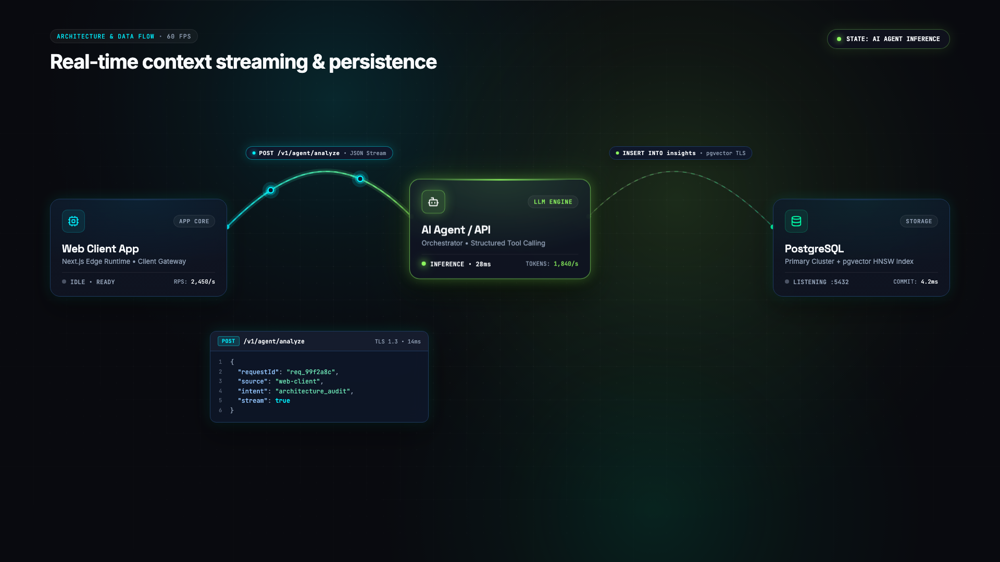 |
| **2.5D Pop-Up Stories (`paper-diorama-3d`)** | **3D Dialogues &amp; Explainers (`isometric-3d`)** |
| 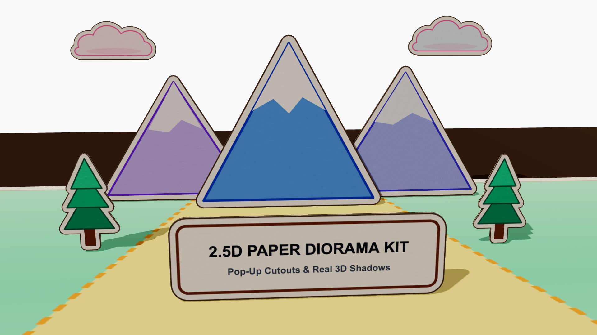 | 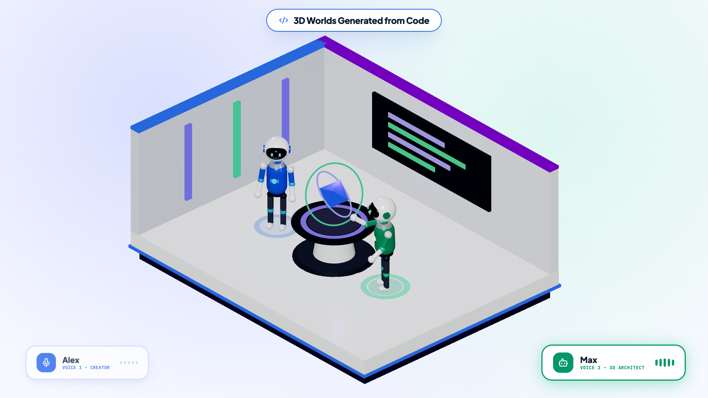 |

<sub>Plus built-in kits for **Editorial Collage**, **Vector Scene 2D**, **Kinetic Typography**, **Data Storytelling** (bar races &amp; timelines), and **Optical VFX** — in both `16:9` and `9:16` Shorts (`Golden Safe Box`).</sub>

---

## 🔄 How AI direction works in practice

| 1. First prompt (rough 3D) | 2. Style experiment (flat 2D) | 3. Final 2.5D pop-up shot |
| :---: | :---: | :---: |
| 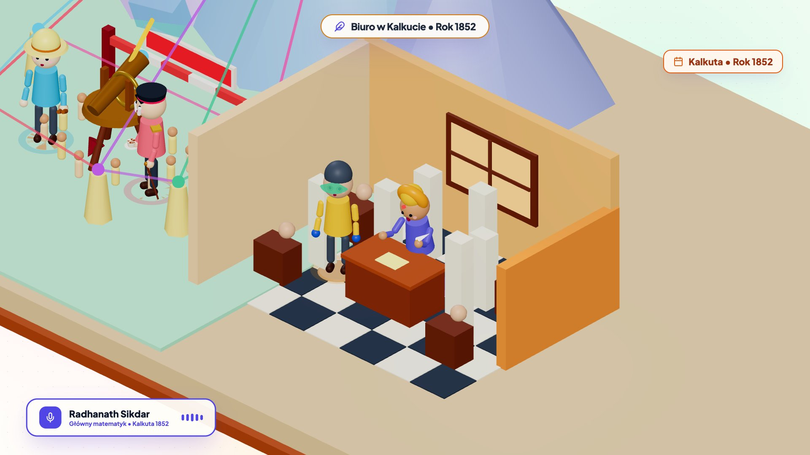 | 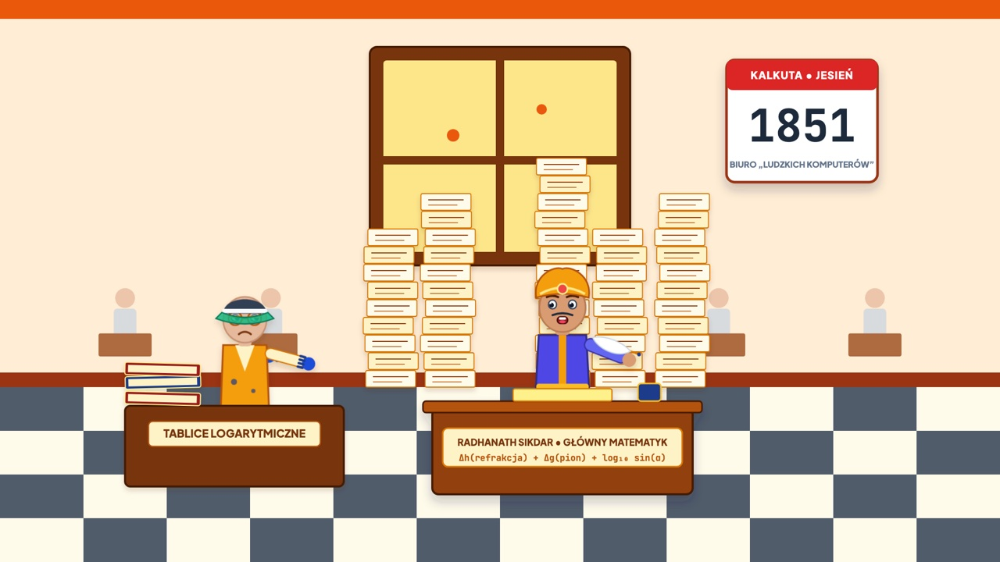 | 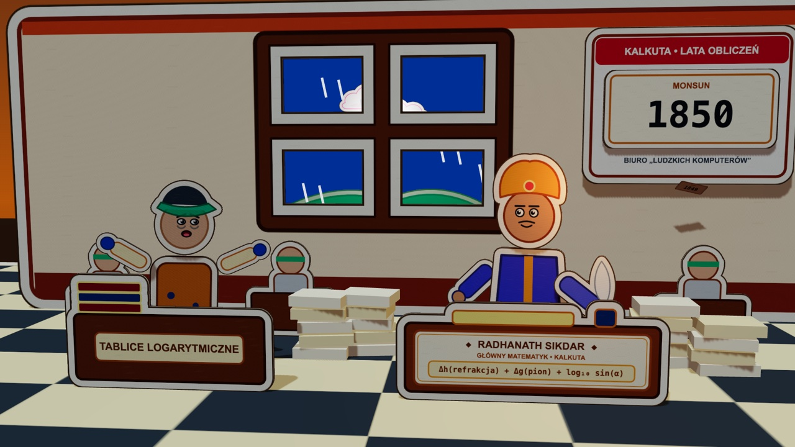 |

<p align="center">
  <a href="https://www.youtube.com/watch?v=IL4jrUKzkOA">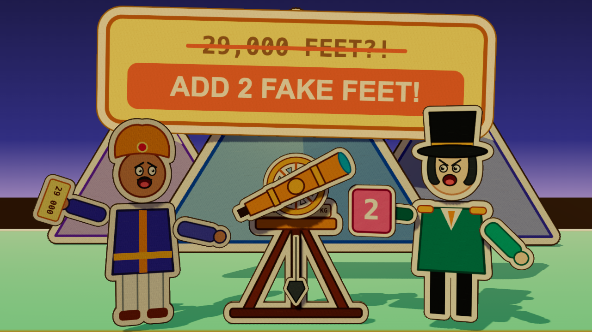</a>
  <br />
  <sub>▶ <a href="https://www.youtube.com/watch?v=IL4jrUKzkOA"><strong>Watch the full 2:42 film on YouTube</strong></a> — voice, music, sound effects and every camera move created in <code>make.pictures</code>.</sub>
</p>

---

## 🛠️ For developers — 4 ways to use

```bash
# 1. Standalone video studio repo
npx create-make-pictures@latest my-films --lang=en && cd my-films && npx make-pictures studio

# 2. Inside an existing Next.js / Vite / SaaS repo (import your real React components or .mp4 recordings)
npm i -D @make-pictures/cli @make-pictures/studio @make-pictures/core @make-pictures/kits
npx make-pictures init --dir=videos && npx make-pictures studio --dir=videos

# 3. Interactive web embeds (no MP4 encoding — live React / WebGL via @remotion/player)
npm i @make-pictures/core @make-pictures/kits @remotion/player remotion zod lucide-react

# 4. Install AI Agent Skills directly (skills.sh — Claude Code, Cursor, Antigravity)
npx skills add make-pictures/make-pictures-studio
```

<details>
<summary><strong>📦 Packages &amp; CLI quick reference (<code>v2.2.0</code>)</strong></summary>

<br />

| Package | Purpose |
| :--- | :--- |
| `create-make-pictures` | Zero-config project scaffolder (`npx create-make-pictures@latest <dir>`) |
| `@make-pictures/core` | `60 FPS` runtime, 7 `StylePreset` themes, `DirectorCamera3D/2D`, `SmartMusicBed`, `SoundCue` |
| `@make-pictures/kits` | 7 visual kits + `product-frames` + deterministic `vfx` |
| `@make-pictures/studio` | Local **Studio Web** &amp; **🎨 Style Lab** (`Liquid Glass` UI, timeline, 3-tab inspector) |
| `@make-pictures/cli` | Unified `make-pictures` CLI + 9 auto-discovered `SKILL.md` modules for Antigravity &amp; Claude Code |

| Command | Action |
| :--- | :--- |
| `npx make-pictures onboard` | Browser sign-in for ElevenLabs + studio setup |
| `npx make-pictures studio` | Launch **Studio Web** &amp; **🎨 Style Lab** at `http://127.0.0.1:3000` |
| `npx make-pictures new <slug>` | Create a new video capsule (`--kit=...`, `--style=...`, `--lang=en\|pl`) |
| `npx make-pictures styles` | List built-in &amp; custom `styles/*.style.json` presets (`style new <slug>` to fork) |
| `npx make-pictures audio` | Generate word-aligned voiceovers, sidechain-ducked music &amp; SFX |
| `npx make-pictures qa <Id>` | Render a 12-frame Contact-Sheet PNG (`out/qa-<Id>.png`) with `9:16` safe zones |
| `npx make-pictures render <Id>` | Export `60 FPS` MP4 mastered to `-14 LUFS` |

</details>

---

<p align="center">
  MIT License • <a href="https://make.pictures">make.pictures</a> • <a href="https://buycoffee.to/makepictures">☕ Buy me a coffee</a>
</p>
