<p align="center">
  <a href="https://make.pictures">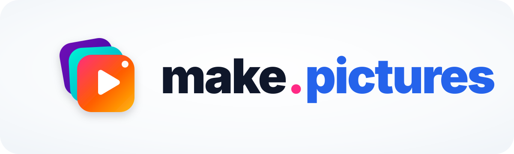</a>
</p>

<p align="center">
  <a href="https://www.npmjs.com/package/@make-pictures/remotion"></a>
  
  
  <a href="./LICENSE"></a>
</p>

<h3 align="center">Production &amp; Audio/QA Toolkit for Remotion + AI Agents.</h3>

<p align="center">
  <a href="https://make.pictures">🌐 make.pictures</a> •
  <a href="https://www.youtube.com/@makepicturestv">📺 YouTube (EN)</a> •
  <a href="https://www.youtube.com/@makepicturespl">📺 YouTube (PL)</a> •
  <a href="./docs/MIGRATION-v3.md">🔄 v3 Migration Guide</a> •
  <a href="./CHANGELOG.md">📋 Changelog</a> •
  <a href="./README.pl.md">🇵🇱 Polska wersja</a>
</p>

---

> **Remotion is the engine and editing studio** (`npx remotion studio`, `remotion render`, `@remotion/player`).
> **`make.pictures` is the production layer and director harness for AI agents:** 2D / 2.5D / 3D visual kits, 10 art-direction styles, ElevenLabs `eleven_v4` audio + `-14 LUFS` mastering, Remotion Elements, and a hard visual QA gate — with **zero lock-in**.

## ⚡ Start with one prompt

`1. Paste into Antigravity, Claude Code, Cursor, or Codex` → `2. Describe your idea & pick a style in StyleLab` → `3. Preview & export in native Remotion Studio`

```text
Set up make.pictures for me: run `npx -y @make-pictures/cli@latest onboard --lang=en` and follow every step until Remotion Studio is running.
```

Works seamlessly in **three modes**:
1. **Empty directory** → scaffolds a clean Remotion 4 + React 19 project (`create-make-pictures`) with `StyleLab` in `src/Root.tsx`.
2. **Existing Remotion project** (`npx create-video@latest`) → runs `npx make-pictures init` in-place without touching your existing `src/Root.tsx`.
3. **Existing web / SaaS app** (Next.js, Vite, etc.) → initializes an isolated `--dir=videos` Remotion workspace.

---

## 🎨 Native Remotion Studio + `StyleLab` & Visual Kits (`v3.0.0`)

<p align="center">
  <a href="https://make.pictures">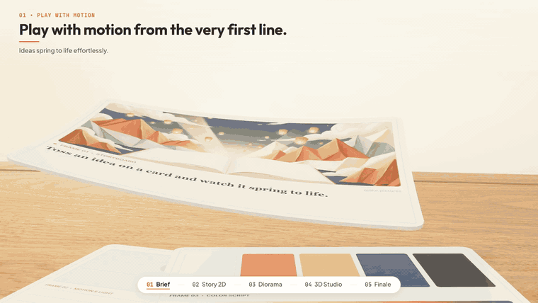</a>
  <br />
  <sub>▶ <strong>49s Showreel — One Page, Five Worlds</strong> — <strong>Tactile 3D • 2D Product Flow • 2.5D Paper Cutouts • Soft-Clay 3D Dialogue • Editorial Panorama</strong> (watch with voice &amp; music at <a href="https://make.pictures">make.pictures</a>).</sub>
</p>

<p align="center">
  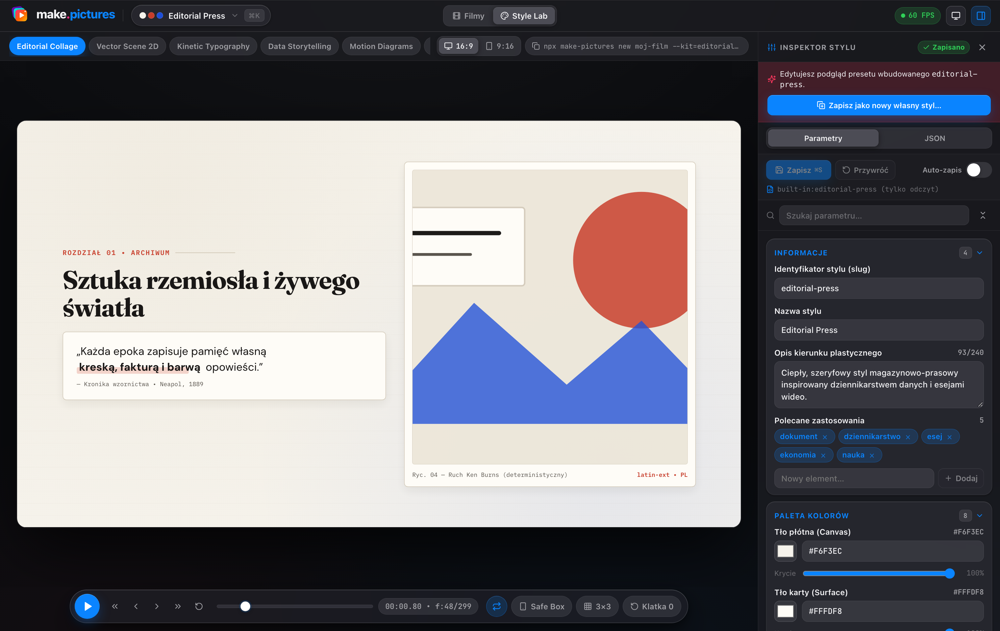
  <br />
  <sub><strong>🎨 Native <code>StyleLab</code> Composition</strong> (<code>@make-pictures/remotion/style-lab</code>) — switch <strong>2D / 2.5D / 3D</strong> spaces and <strong>10 built-in art direction presets</strong> directly inside Remotion Studio's Props panel at 60 FPS.</sub>
</p>

---

## 🎬 What you can build in minutes

| Product Launch &amp; Live Sync (`product-frames`) | 2D Systems Choreography (`motion-diagrams-2d`) |
| :---: | :---: |
| 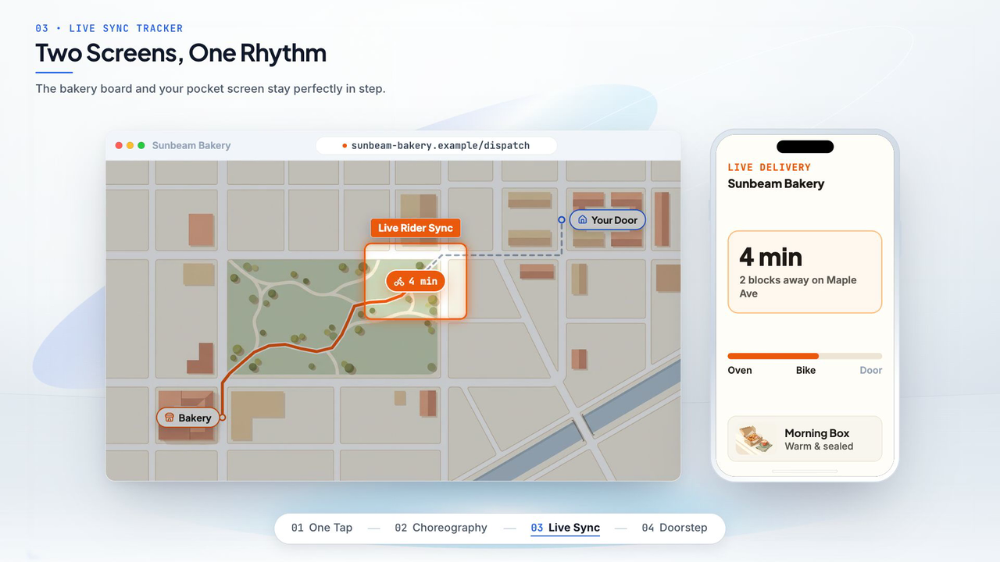 | 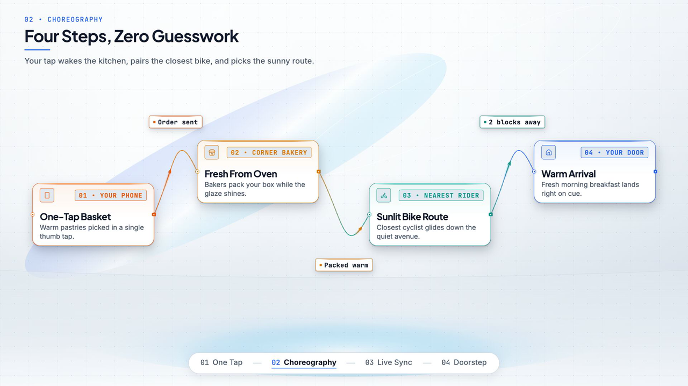 |
| **Editorial Panorama &amp; Pinned Media (`editorial-collage`)** | **Data Storytelling &amp; Bar Races (`data-storytelling`)** |
| 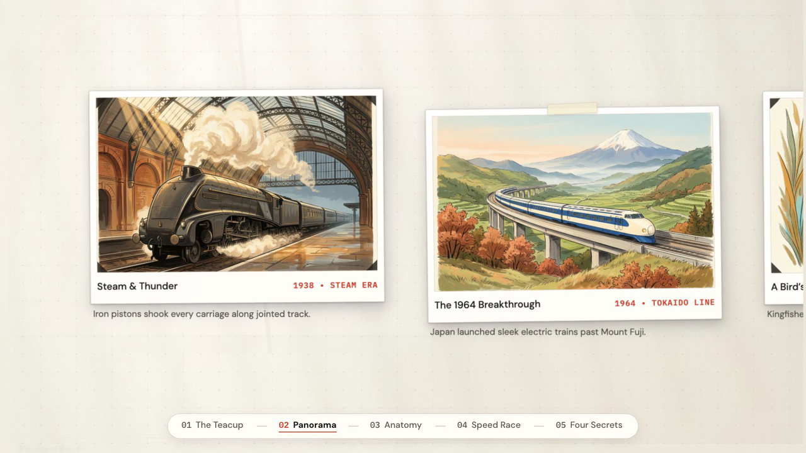 | 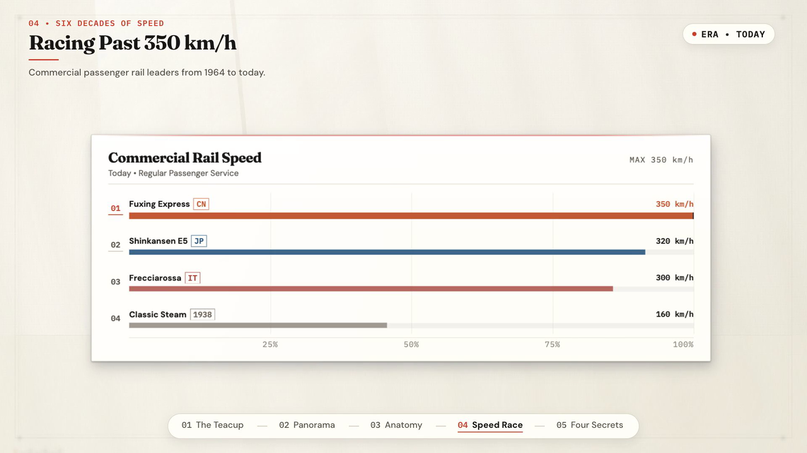 |
| **2.5D Paper Cutouts &amp; Dioramas (`paper-diorama-3d`)** | **Soft-Clay 3D &amp; Text-to-Dialogue (`isometric-3d`)** |
| 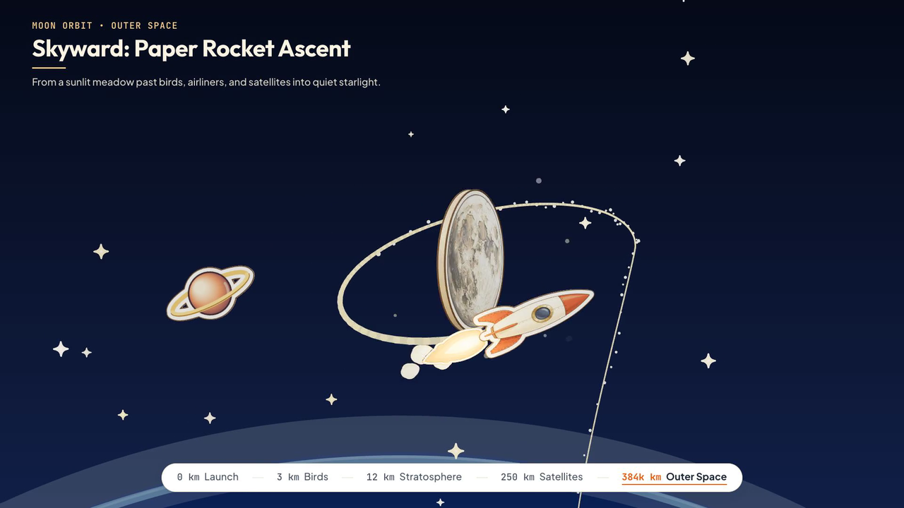 | 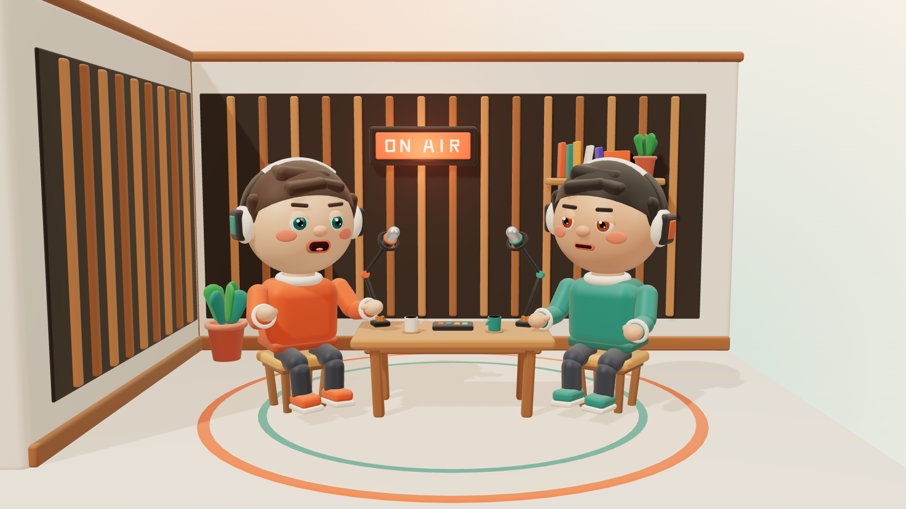 |

<sub>10 tree-shakeable visual kits in `@make-pictures/remotion/kits/*` across **`2D` / `2.5D` / `3D`** (`editorial-collage`, `vector-scene-2d`, `motion-diagrams-2d`, `kinetic-typography`, `data-storytelling`, `product-frames`, `vfx`, `paper-diorama-3d`, `isometric-3d`, `tactile-3d`) — with optional 3D peer dependencies so 2D projects never install Three.js.</sub>

---

## 🔄 How AI direction works in practice

| 1. First prompt (rough 3D) | 2. Style experiment (flat 2D) | 3. Final 2.5D pop-up shot |
| :---: | :---: | :---: |
| 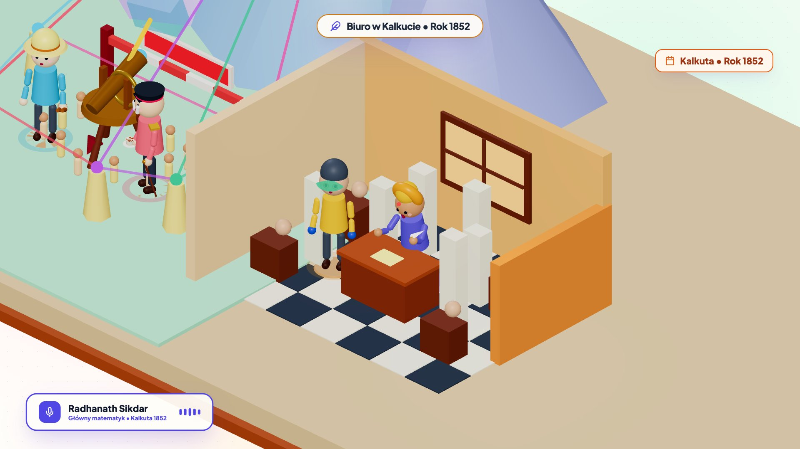 | 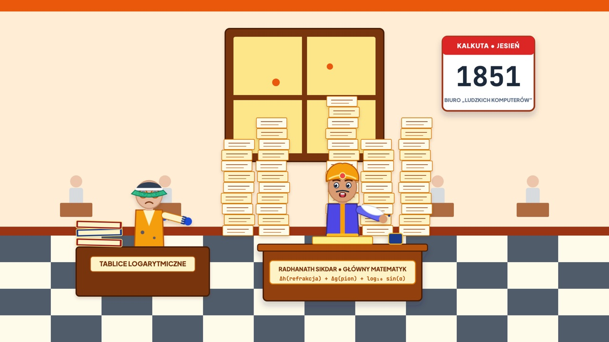 | 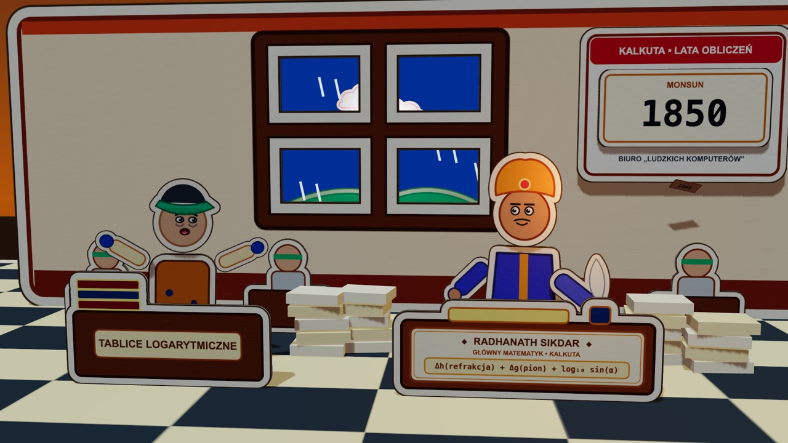 |

<p align="center">
  <a href="https://www.youtube.com/watch?v=IL4jrUKzkOA">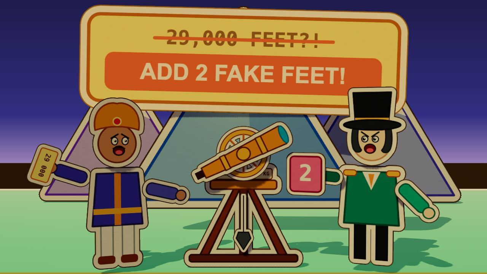</a>
  <br />
  <sub>▶ <a href="https://www.youtube.com/watch?v=IL4jrUKzkOA"><strong>Watch the full 2:42 film on YouTube</strong></a> — voice, music, sound effects and every camera move created with <code>make.pictures</code> + Remotion.</sub>
</p>

---

## 🛠️ For developers — 5 ways to use

```bash
# 1. Start a fresh Remotion 4 + React 19 project
npx create-make-pictures@latest my-films --lang=en && cd my-films && npx remotion studio

# 2. Add to ANY existing Remotion project (zero lock-in, preserves your src/Root.tsx)
npm i @make-pictures/remotion && npm i -D @make-pictures/cli
npx make-pictures init

# 3. Embed inside an existing Next.js / Vite / SaaS repo
npx make-pictures init --dir=videos

# 4. Install tandem AI Agent Skills (official Remotion API + 5 lean make.pictures production skills)
npx remotion skills add
npx skills add make-pictures/make-pictures-studio

# 5. Export or install standalone Remotion Elements (@remotion/studio-protocol)
npx make-pictures elements build --out=dist/elements
```

<details>
<summary><strong>📦 Packages &amp; CLI quick reference (<code>v3.0.0</code>)</strong></summary>

<br />

| Package | Purpose |
| :--- | :--- |
| `@make-pictures/remotion` | Unified `60 FPS` runtime: 10 visual kits, 10 `StylePreset` worlds, `ContinuousSceneFlow`, Shot DSL cameras, Disney kinematics + 15-axis 3D SAT collision audit, `SmartMusicBed`, `SoundCue`, `<StyleLabComposition />`, and 7 Remotion Elements (`sideEffects: false`, zero-`three` root) |
| `@make-pictures/cli` | Universal Remotion CLI: `onboard`, `init`, `new`, `audio` (`eleven_v4` TTS / Text-to-Dialogue / Music / SFX), `voices`, `image`, `cutout`, `assets`, native `selectComposition` `qa`, `-14 LUFS` `render`, `elements build`, plus 5 bundled `SKILL.md` modules |
| `create-make-pictures` | Ultra-thin scaffolder for fresh Remotion 4 + React 19 projects with native `StyleLab` |

| Command | Action |
| :--- | :--- |
| `npx make-pictures onboard` | 3-mode onboarding + tandem skills + optional ElevenLabs `.env.local` auth |
| `npx make-pictures init` | Add toolkit to an existing Remotion repo (or `--dir=videos` in a SaaS app) |
| `npx make-pictures studio` | Launch native **`npx remotion studio`** |
| `npx make-pictures new <slug>` | Scaffold `src/videos/<slug>/` (`audio.json` + component) and register `<Composition>` in `src/Root.tsx` |
| `npx make-pictures styles` | List 10 built-in &amp; custom `styles/*.style.json` presets (`style new <slug>` to fork) |
| `npx make-pictures audio [slug]` | Generate word-aligned `eleven_v4` voiceovers, multi-speaker Text-to-Dialogue, music &amp; SFX (`--mock` offline) |
| `npx make-pictures qa <Id>` | Native `selectComposition` Director QA gate &amp; Contact-Sheet PNG (`out/qa-<Id>.png`) with `9:16` safe zones |
| `npx make-pictures render <Id>` | Export `60 FPS` MP4 (auto `--gl=angle` for 3D) mastered to `-14 LUFS` |
| `npx make-pictures elements build` | Build `@remotion/studio-protocol` JSON/HTML payloads for all 7 flagship Remotion Elements |

</details>

---

<p align="center">
  MIT License • <a href="https://make.pictures">make.pictures</a> • <a href="./docs/MIGRATION-v3.md">Migration Guide (v2 → v3)</a> • <a href="https://buycoffee.to/makepictures">☕ Buy me a coffee</a>
</p>
