<p align="center">
  <a href="https://make.pictures">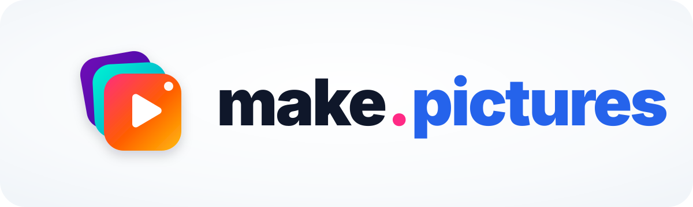</a>
</p>

<p align="center">
  <a href="https://www.npmjs.com/package/@make-pictures/remotion"></a>
  
  
  <a href="./LICENSE"></a>
</p>

<h3 align="center">Warstwa produkcyjna, zestawy wizualne 2D/2.5D/3D, audio ElevenLabs i bramka QA dla Remotion + Agentów AI.</h3>

<p align="center">
  <a href="https://make.pictures">🌐 make.pictures</a> •
  <a href="https://www.youtube.com/@makepicturespl">📺 YouTube (PL)</a> •
  <a href="https://www.youtube.com/@makepicturestv">📺 YouTube (EN)</a> •
  <a href="./docs/MIGRATION-v3.md">🔄 Przewodnik migracji v3</a> •
  <a href="./CHANGELOG.md">📋 Changelog</a> •
  <a href="./README.md">🇬🇧 English version</a>
</p>

---

> **Remotion jest silnikiem i studiem montażowym** (`npx remotion studio`, `remotion render`, `@remotion/player`).
> **`make.pictures` jest warstwą produkcyjną i reżyserskim harnessem dla agentów AI:** gotowe światy `2D / 2.5D / 3D`, 10 stylów kierownictwa artystycznego, pipeline audio ElevenLabs `eleven_v4` + mastering `-14 LUFS`, Remotion Elements i twarda bramka QA — przy **zerowym lock-in**.

## ⚡ Start jednym promptem

`1. Wklej w Antigravity, Claude Code, Cursor lub Codex` → `2. Wybierz przestrzeń i styl w StyleLab` → `3. Podglądaj i renderuj w natywnym Remotion Studio`

```text
Przygotuj dla mnie środowisko filmowe make.pictures: uruchom `npx -y @make-pictures/cli@latest onboard --lang=pl` i wykonaj wszystkie kroki aż do uruchomienia podglądu w Remotion Studio.
```

Działa w **trzech trybach**:
1. **Pusty katalog** → tworzy czysty projekt Remotion 4 + React 19 (`create-make-pictures`) z gotową kompozycją `StyleLab` w `src/Root.tsx`.
2. **Istniejący projekt Remotion** (`npx create-video@latest`) → uruchamia `npx make-pictures init` w miejscu, nie ruszając Twojego `src/Root.tsx`.
3. **Istniejąca aplikacja WWW / SaaS** (Next.js, Vite itp.) → inicjalizuje izolowany podkatalog `--dir=videos`.

---

## 🎨 Natywne Remotion Studio + `StyleLab` i zestawy wizualne (`v3.0.0`)

<p align="center">
  <a href="https://make.pictures">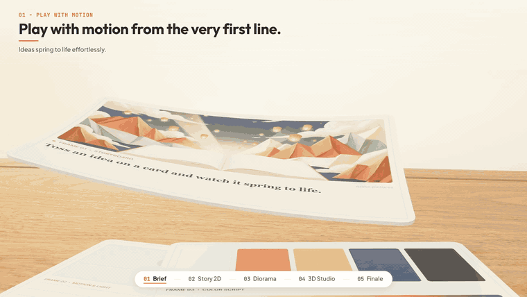</a>
  <br />
  <sub>▶ <strong>Showreel 49 s — Jedna kartka, pięć światów</strong> — <strong>Tactile 3D • Przepływ produktu 2D • Wycinanki 2.5D • Dialog Soft-Clay 3D • Panorama redakcyjna</strong> (obejrzyj z głosem i muzyką na <a href="https://make.pictures">make.pictures</a>).</sub>
</p>

<p align="center">
  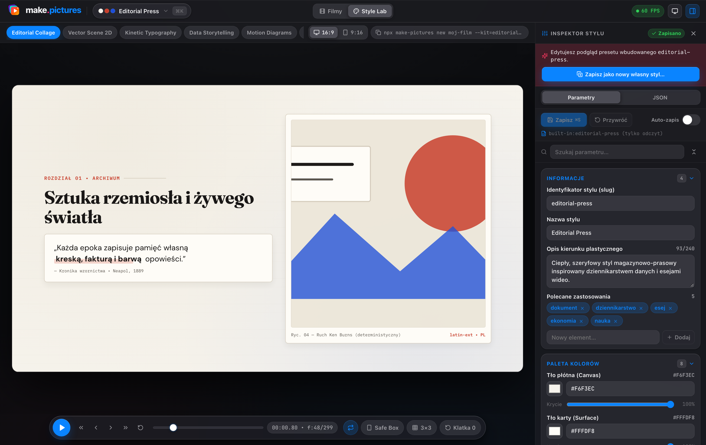
  <br />
  <sub><strong>🎨 Natywna kompozycja <code>StyleLab</code></strong> (<code>@make-pictures/remotion/style-lab</code>) — przełączaj przestrzenie <strong>2D / 2.5D / 3D</strong> oraz <strong>10 wbudowanych stylów</strong> bezpośrednio w panelu Props Remotion Studio przy 60 FPS.</sub>
</p>

---

## 🎬 Co stworzysz w kilkanaście minut

| Premiera produktu i Live Sync (`product-frames`) | Choreografia systemów 2D (`motion-diagrams-2d`) |
| :---: | :---: |
| 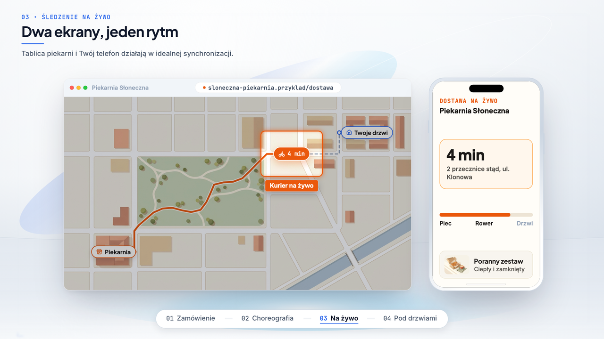 | 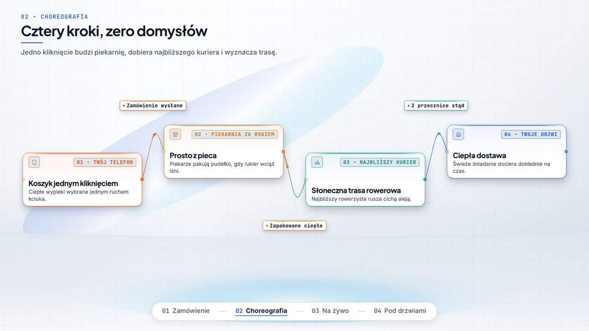 |
| **Panorama redakcyjna i Pinned Media (`editorial-collage`)** | **Wizualizacja danych i wyścigi słupków (`data-storytelling`)** |
| 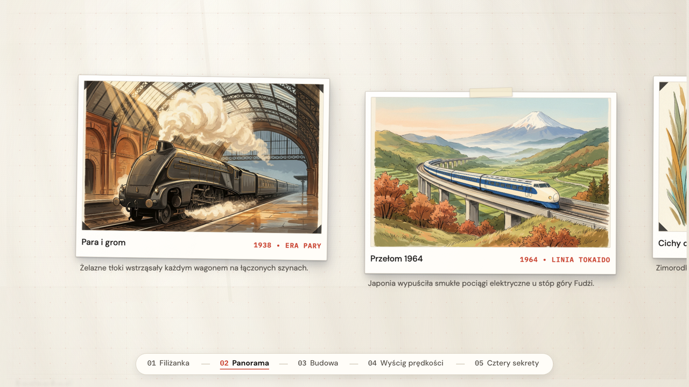 | 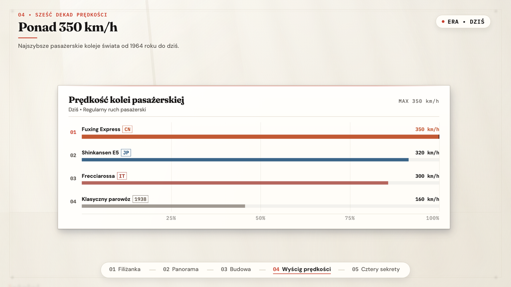 |
| **Wycinanki i dioramy 2.5D (`paper-diorama-3d`)** | **Soft-Clay 3D i Text-to-Dialogue (`isometric-3d`)** |
| 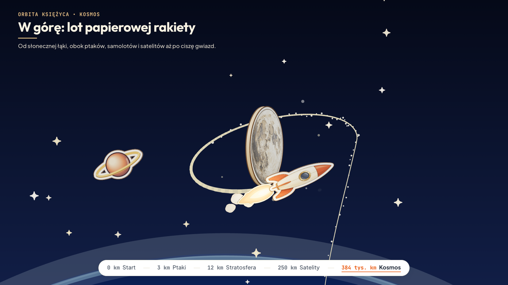 | 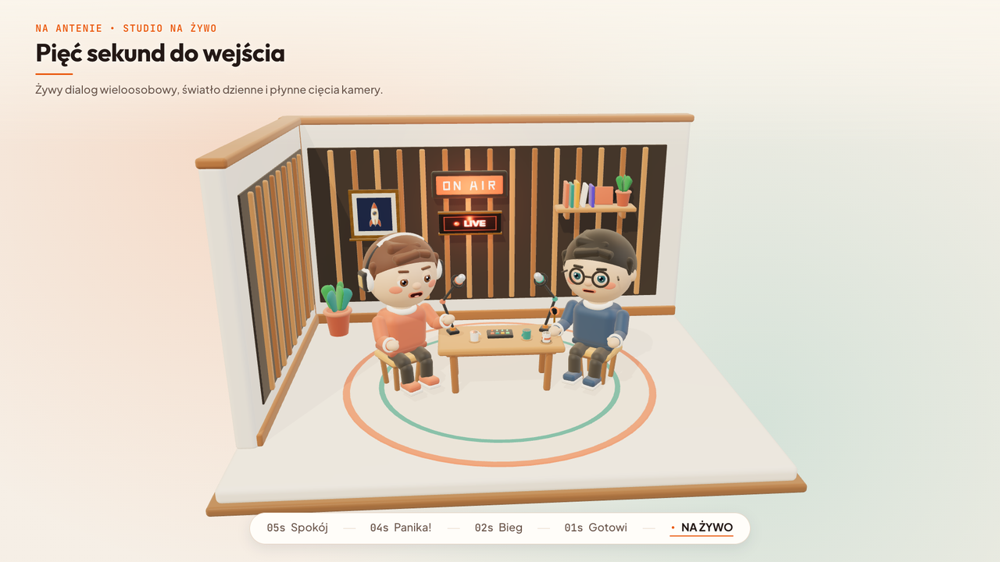 |

<sub>10 odizolowanych zestawów w `@make-pictures/remotion/kits/*` dla przestrzeni **`2D` / `2.5D` / `3D`** (`editorial-collage`, `vector-scene-2d`, `motion-diagrams-2d`, `kinetic-typography`, `data-storytelling`, `product-frames`, `vfx`, `paper-diorama-3d`, `isometric-3d`, `tactile-3d`) — z opcjonalnymi zależnościami 3D, dzięki czemu projekty 2D nie wymagają Three.js.</sub>

---

## 🔄 Jak wygląda reżyseria z AI w praktyce

| 1. Pierwszy prompt (surowy szkic) | 2. Zmiana podejścia (płaskie 2D) | 3. Finałowy kadr 2.5D |
| :---: | :---: | :---: |
| 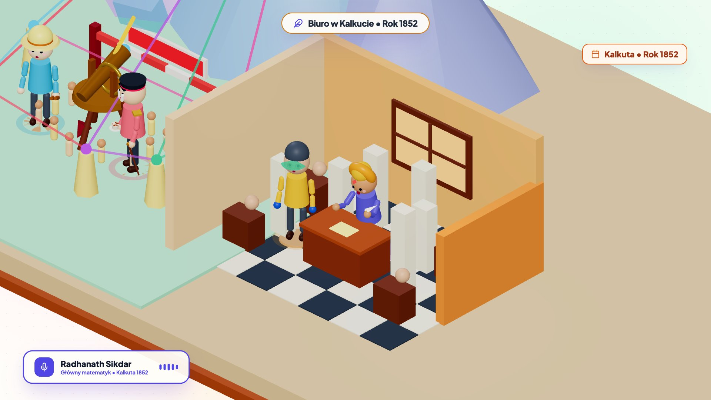 | 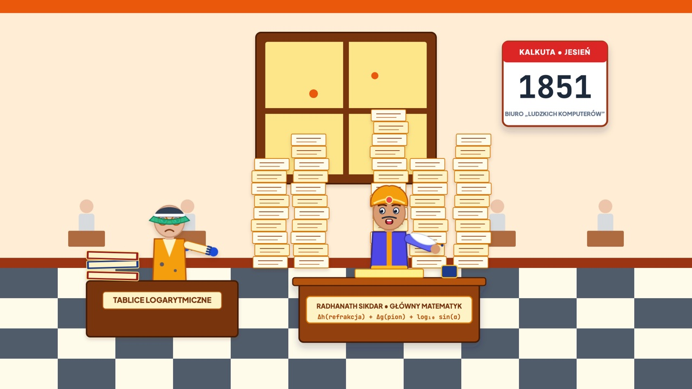 | 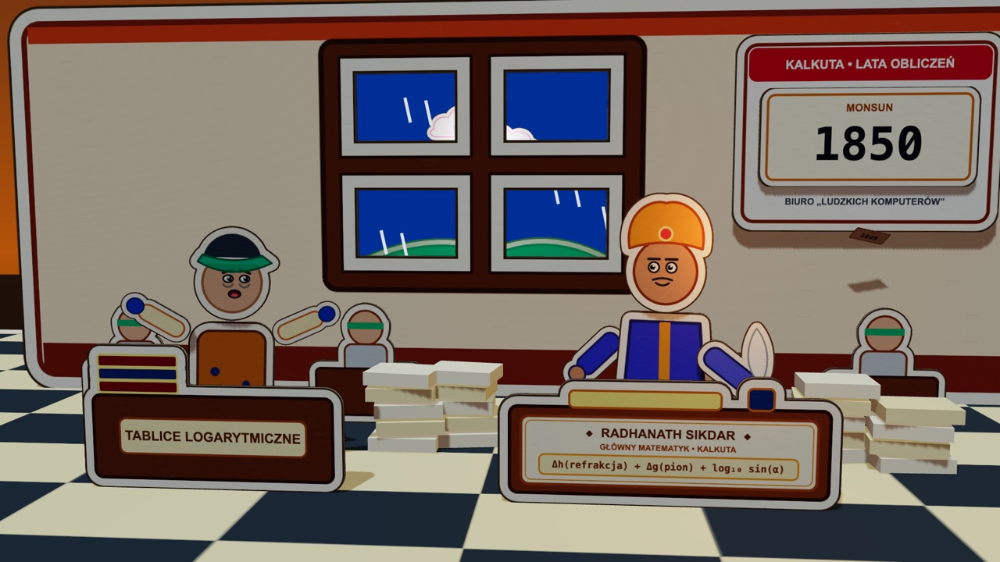 |

<p align="center">
  <a href="https://www.youtube.com/watch?v=4t-hVA3OxSY">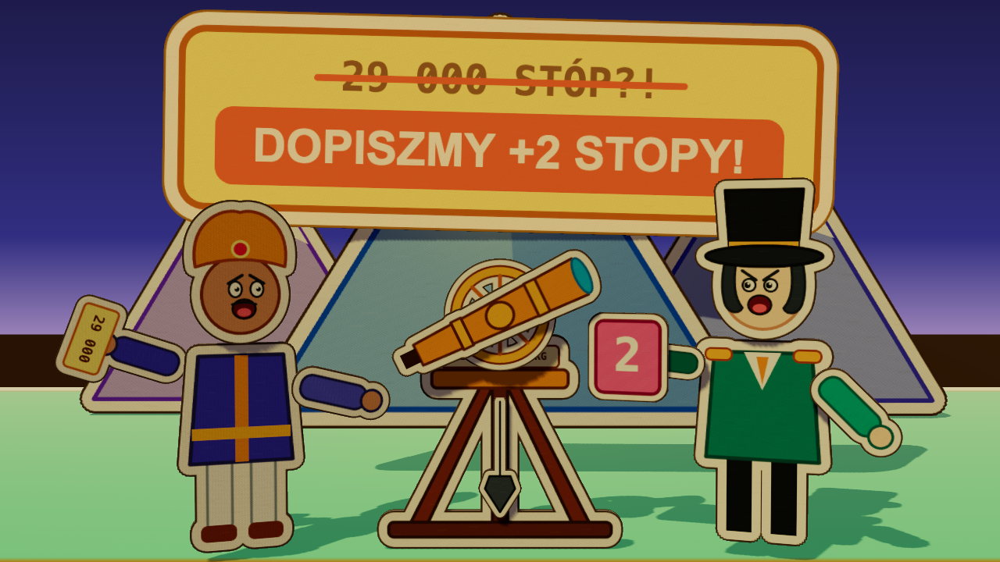</a>
  <br />
  <sub>▶ <a href="https://www.youtube.com/watch?v=4t-hVA3OxSY"><strong>Zobacz gotowy film 2:42 na YouTube</strong></a> — głos, muzyka, efekty dźwiękowe i każdy ruch kamery powstały w <code>make.pictures</code> + Remotion.</sub>
</p>

---

## 🛠️ Dla developerów — 5 sposobów użycia

```bash
# 1. Świeży projekt Remotion 4 + React 19
npx create-make-pictures@latest moje-filmy --lang=pl && cd moje-filmy && npx remotion studio

# 2. Dodatek do DOWOLNEGO istniejącego projektu Remotion (zero lock-in, nie nadpisuje src/Root.tsx)
npm i @make-pictures/remotion && npm i -D @make-pictures/cli
npx make-pictures init --lang=pl

# 3. Wewnątrz istniejącej aplikacji Next.js / Vite / SaaS
npx make-pictures init --dir=videos --lang=pl

# 4. Instalacja tandemowych skilli agenta AI (oficjalne API Remotion + 5 skilli produkcyjnych make.pictures)
npx remotion skills add
npx skills add make-pictures/make-pictures-studio

# 5. Eksport samodzielnych komponentów Remotion Elements (@remotion/studio-protocol)
npx make-pictures elements build --out=dist/elements
```

<details>
<summary><strong>📦 Pakiety npm i ściąga komend CLI (<code>v3.0.0</code>)</strong></summary>

<br />

| Pakiet | Rola |
| :--- | :--- |
| `@make-pictures/remotion` | Jedyna biblioteka runtime `60 FPS`: 10 kitów wizualnych, 10 stylów `StylePreset`, `ContinuousSceneFlow`, kamery Shot DSL, kinematyka Disneya + 15-osiowy audyt kolizji 3D SAT, `SmartMusicBed`, `SoundCue`, `<StyleLabComposition />` i 7 Remotion Elements (`sideEffects: false`, zero `three` w root) |
| `@make-pictures/cli` | Uniwersalne CLI dla Remotion: `onboard`, `init`, `new`, `audio` (`eleven_v4` TTS / Text-to-Dialogue / Music / SFX), `voices`, `image`, `cutout`, `assets`, natywne `qa` (`selectComposition`), `render` `-14 LUFS`, `elements build` oraz 5 spakowanych skilli `SKILL.md` |
| `create-make-pictures` | Ultracienki scaffolder świeżych projektów Remotion 4 + React 19 z natywnym `StyleLab` |

| Komenda | Działanie |
| :--- | :--- |
| `npx make-pictures onboard` | 3-trybowy onboarding + tandem skilli + opcjonalne podpięcie ElevenLabs (`.env.local`) |
| `npx make-pictures init` | Dodanie toolkitu do istniejącego projektu Remotion (lub `--dir=videos` w aplikacji SaaS) |
| `npx make-pictures studio` | Uruchomienie natywnego **`npx remotion studio`** |
| `npx make-pictures new <slug>` | Szkielet `src/videos/<slug>/` (`audio.json` + komponent) i rejestracja `<Composition>` w `src/Root.tsx` |
| `npx make-pictures styles` | Lista 10 wbudowanych i własnych stylów `styles/*.style.json` (`style new <slug>` tworzy nowy) |
| `npx make-pictures audio [slug]` | Generowanie lektora `eleven_v4` z czasami słów, dialogów Text-to-Dialogue, muzyki i SFX (`--mock` offline) |
| `npx make-pictures qa <Id>` | Natywna bramka QA (`selectComposition`) i styk klatek kontrolnych PNG (`out/qa-<Id>.png`) z ramkami `9:16` |
| `npx make-pictures render <Id>` | Eksport MP4 `60 FPS` (automatyczne `--gl=angle` dla 3D) zmasterowanego do `-14 LUFS` |
| `npx make-pictures elements build` | Budowanie payloadów `@remotion/studio-protocol` dla 7 flagowych komponentów Remotion Elements |

</details>

---

<p align="center">
  Licencja MIT • <a href="https://make.pictures">make.pictures</a> • <a href="./docs/MIGRATION-v3.md">Migracja v2 → v3</a> • <a href="https://buycoffee.to/makepictures">☕ Postaw mi kawę</a>
</p>
