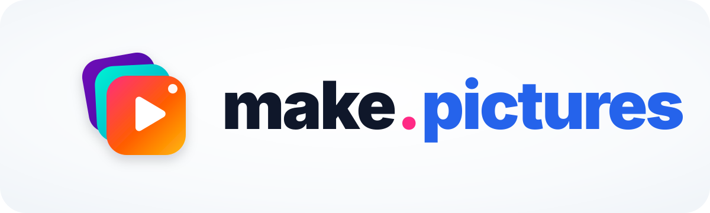
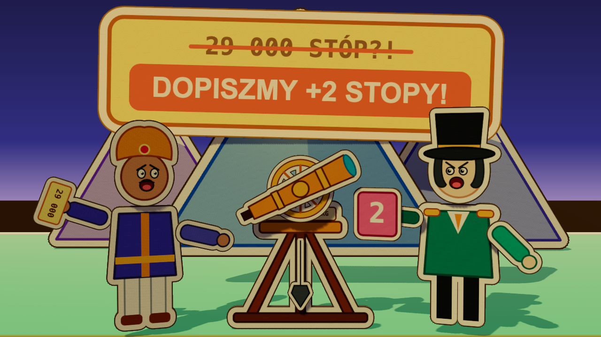
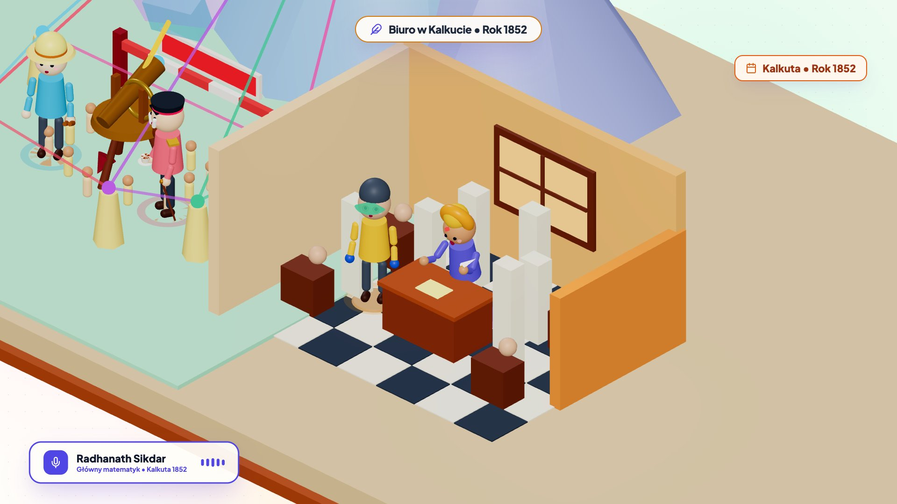
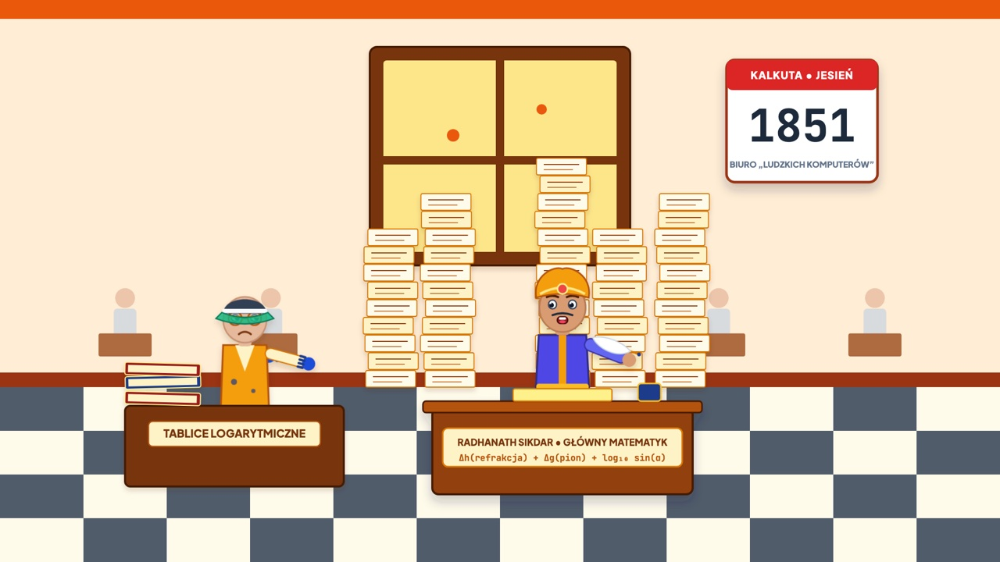
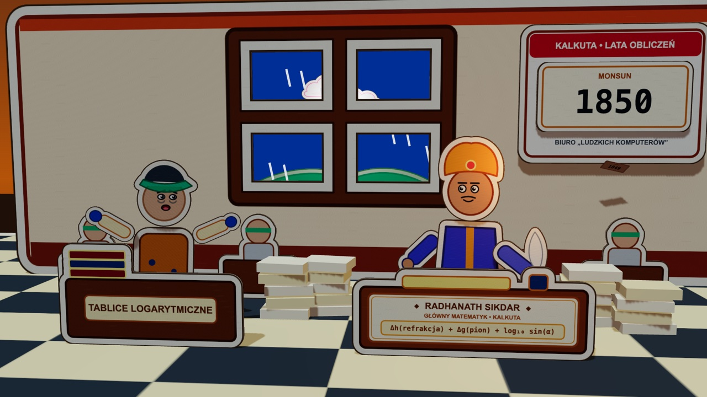

<p align="center">
  <a href="https://make.pictures"></a>
</p>

<p align="center">
  <a href="https://make.pictures"></a>
  
  
  
  <a href="./LICENSE"></a>
</p>

<p align="center">
  <strong>Otwarte studio animacji tworzonych z kodu.</strong><br />
  Zamieniaj pomysły i prawdziwe komponenty React w filmy 60 FPS zmasterowane do -14 LUFS — TypeScript, Remotion, Three.js i ElevenLabs pod reżyserią Google Antigravity oraz Claude Code.
</p>

<p align="center">
  <a href="https://make.pictures">🌐 make.pictures</a> •
  <a href="https://www.youtube.com/@makepicturespl">📺 YouTube (PL) @makepicturespl</a> •
  <a href="https://www.youtube.com/@makepicturestv">📺 YouTube (EN) @makepicturestv</a> •
  <a href="./README.md">🇬🇧 English documentation</a>
</p>

> [!TIP]
> **Utwórz własne studio filmowe 60 FPS w kilka sekund — bez wcześniejszego konta ani klucza API.**
>
> ```bash
> npx create-make-pictures@latest moje-filmy
> cd moje-filmy
> ```
>
> Następnie otwórz katalog `moje-filmy` w **Google Antigravity**, **Claude Code**, **Cursor** lub **Codex** i wklej:
>
> ```text
> Skonfiguruj studio make.pictures: uruchom `npx make-pictures onboard` i wykonuj to, co wypisze.
> ```

---

## 🎬 Odcinek pokazowy — w całości zrobiony w `make.pictures`

<p align="center">
  <a href="https://www.youtube.com/watch?v=4t-hVA3OxSY"></a>
</p>

<p align="center">
  <strong><a href="https://www.youtube.com/watch?v=4t-hVA3OxSY">Dwie stopy na szczycie świata: dlaczego naukowcy dopisali Mount Everestowi 2 fałszywe stopy?</a></strong><br />
  <sub>Jak w 1852 roku zmierzono Mount Everest z odległości 200 km — każda klatka, ruch kamery, kwestia lektora i efekt dźwiękowy to TypeScript w 60 FPS.</sub>
</p>

### Od „kamery przemysłowej” do papierowej księgi 2.5D — 3 etapy reżyserii z AI

Kolejne iteracje promptów w `make.pictures` przeprowadziły tę samą scenę biura pomiarowego w Kalkucie od surowej geometrii do ujęcia gotowego do emisji:

| Etap 1 — Surowa geometria | Etap 2 — Wycinanki i głębia | Etap 3 — Światło, atmosfera i kamera |
| :---: | :---: | :---: |
|  |  |  |
| Surowe 3D: stosy papieru to białe słupy, a rachmistrzowie to kulki na klockach. | Płaskie 2D SVG: podłoga wygląda jak kafelki łazienkowe, a ręce jak semafory. | Papierowe wycinanki z kremową obwódką i grubością tektury, oświetlone słońcem z okna. |

---

## 🚀 3 oficjalne sposoby użycia `make.pictures` 2.0

### 1. Samodzielne studio wideo (`npx create-make-pictures@latest`)
Dedykowane repozytorium Git dla kanału, agencji lub serii edukacyjnej. Filmy w `productions/*` są Twoim kodem śledzonym w Git, a cały silnik działa z `node_modules/@make-pictures/*`. Wtyczka AI jest automatycznie podłączona dla każdego agenta (`AGENTS.md` + `.agents/plugins/make-pictures/` oraz `CLAUDE.md` + `.claude/skills/`):

```bash
npx create-make-pictures@latest moje-filmy --kit=paper-diorama-3d --lang=pl
cd moje-filmy
npx make-pictures onboard
npx make-pictures studio
```

### 2. Wewnątrz istniejącej aplikacji SaaS / web (`npx make-pictures init`)
Dodaje studio wideo 60 FPS do projektu Next.js, Vite lub monorepo. Tworzy `videos/productions/` i synchronizuje skille AI w katalogu głównym repozytorium, dzięki czemu agent może importować **Twoje prawdziwe komponenty React** — albo nagrania ekranu `.mp4` — i zamieniać je w zwiastuny i dema produktu:

```bash
npm i -D @make-pictures/cli @make-pictures/studio @make-pictures/core @make-pictures/kits
npx make-pictures init --dir=videos --kit=motion-diagrams-2d --lang=pl
npx make-pictures studio --dir=videos
```

### 3. Interaktywne osadzanie na stronie (`@make-pictures/core` + `@make-pictures/kits`)
Osadzaj diagramy architektury, wyścigi słupków czy sceny 3D w 60 FPS na stronach React / Next.js przez `@remotion/player` — ostra grafika wektorowa i WebGL bez kodowania MP4:

```bash
npm i @make-pictures/core @make-pictures/kits @remotion/player remotion zod lucide-react
```

```tsx
import { Player } from '@remotion/player';
import { DirectorCamera2D } from '@make-pictures/core/camera';
import { WorldBox, FlowCurve, portRight, portLeft } from '@make-pictures/kits/motion-diagrams-2d';
```

---

## 📦 Ekosystem pakietów npm (`v2.0.0`)

| Pakiet | Rola |
| :--- | :--- |
| **`create-make-pictures`** | Kreator nowego repozytorium studia (`npx create-make-pictures@latest <katalog>`) |
| **`@make-pictures/core`** | Deterministyczne jądro 60 FPS: `defineProduction`, `SPRING_PRESETS`, `createSeededRandom`, kamera Shot DSL `DirectorCamera3D` / `DirectorCamera2D`, auto-ducking `<SmartMusicBed />`, `<SoundCue />`, `VoiceAcousticPreset` |
| **`@make-pictures/kits`** | Zestawy wizualne jako subścieżki: `paper-diorama-3d`, `isometric-3d`, `motion-diagrams-2d`, `kinetic-typography`, `data-storytelling`, `product-frames` oraz deterministyczne `vfx` |
| **`@make-pictures/studio`** | Lokalne **Studio Web** 60 FPS z HMR i serwerem Vite (Multi-Track Director Timeline, Golden Safe Box `9:16`, Props Inspector `zod` ↔ `*.props.json`) |
| **`@make-pictures/cli`** | Zunifikowane CLI `make-pictures` (`onboard`, `doctor`, `init`, `new`, `audio`, `music`, `sfx`, `studio`, `qa`, `render`, `image`) z wbudowaną wtyczką AI |

---

## ✨ Kluczowe możliwości Studio

- **Zintegrowane studio audio AI (1 klucz API = lektor + muzyka + SFX):**
  - **Lektor z timestampami słów i filtrami akustycznymi:** synchronizacja co do milisekundy (`eleven_multilingual_v2`) i deklaratywne presety `VoiceAcousticPreset` (`clean`, `telephone`, `radio-walkie`, `cathedral`, `megaphone`, `excitement-boost`).
  - **Muzyka AI z auto-duckingiem (`<SmartMusicBed />`):** ścieżki ElevenLabs Music (`prompt` lub sekcje `composition-plan`), wyciszanie pod dialogami z wyprzedzeniem, puls basu `useMusicBeatPulse` i 6 proceduralnych presetów offline.
  - **Efekty AI i foley zsynchronizowany ze słowami (`<SoundCue />`):** ElevenLabs Sound Effects wyzwalane w konkretnej klatce lub na wypowiadanym słowie (`onWord`), z automatycznym masteringiem **EBU R128 `-14 LUFS`**.
- **Deklaratywna kamera Shot DSL (`DirectorCamera3D` i `DirectorCamera2D`):** język filmowy (`establishing-wide`, `medium-two-shot`, `close-up`, `over-the-shoulder`, `low-angle-hero`, `high-crane`, `cut | glide | whip | orbit`, `dolly-zoom`), deterministyczny oddech kamery i wstrząsy, a także automatyczne kadrowanie do **Golden Safe Box `9:16` (`x ∈ [40, 910], y ∈ [220, 1380]`)** dla Shorts / Reels / TikTok.
- **Deterministyczne VFX 60 FPS (`@make-pictures/kits/vfx`):** `CinematicLensOverlay` sprzężony z prędkością kamery (winieta, ziarno, aberracja przy panoramach `whip`, flary), analityczne `ParticleField`, mgła `StagePostProcessing3D` i przejścia `SceneTransition`.
- **Screencasty SaaS (`@make-pictures/kits/product-frames`):** wrzuć `.mp4` do `productions/<slug>/assets/videos/` i oprawiaj je w `BrowserFrame` / `PhoneFrame` z podświetleniami `ScreenSpotlightOverlay` oraz zbliżeniami `DirectorCamera2D`.
- **12-klatkowy Contact-Sheet QA (`npx make-pictures qa <Id>`):** jedna komenda generuje `out/qa-<Id>.png` z numerami klatek i obrysem stref `9:16` do szybkiej kontroli przez człowieka i AI.
- **Przenośna wtyczka AI bez konfiguracji:** natywne wykrywanie w **Google Antigravity** (`.agents/plugins/make-pictures/`) i **Claude Code** (`.claude/skills/` + `CLAUDE.md`), 7 progresywnych skilli `SKILL.md` i zwięzły kodeks `AGENTS.md` zmniejszający bazowy kontekst o **~80%**.

---

## 🎨 Zestawy wizualne i VFX (`@make-pictures/kits`)

| Zestaw (kit) | Ścieżka importu | Główne komponenty | Zastosowanie |
| :--- | :--- | :--- | :--- |
| **1. Paper Diorama 3D** *(księga pop-up 2.5D)* | `@make-pictures/kits/paper-diorama-3d` | `PaperCutout3D`, `ImageCutout3D`, `PopUpHinge3D`, `PopUpBookBase3D`, `PaperBookPageTurn3D`, `PaperStageLighting3D` | Storytelling, historie naukowe i historyczne, teatrzyk z tektury |
| **2. Isometric 3D Studio** | `@make-pictures/kits/isometric-3d` | `Stylized3DCharacter`, `IsometricStudioEnvironment` | Dialogi postaci 3D, podcasty, explainery technologiczne |
| **3. Motion Diagrams 2D** | `@make-pictures/kits/motion-diagrams-2d` | `DirectorCamera2D` / `CameraRig`, `NodeBox` (`portTop/Bottom/Left/Right`), `FlowCurve`, `DataFlowEdge`, `SystemNode` | Architektura systemów, przepływy SaaS, nieskończone płótno |
| **4. Kinetic Typography** | `@make-pictures/kits/kinetic-typography` | `WordByWordStage`, `ImpactKeywordCard`, `AnimatedMetricCounter` | Dynamiczne Shortsy / Reelsy, akcentowanie słów, liczniki KPI |
| **5. Data Storytelling** | `@make-pictures/kits/data-storytelling` | `AnimatedBarRace`, `TimelineTrack`, `MetricComparisonCard` | Wyścigi słupków, osie czasu, porównania przed/po |
| **6. Cinematic VFX** | `@make-pictures/kits/vfx` | `CinematicLensOverlay`, `ParticleField`, `StagePostProcessing3D`, `ContactShadowDisc3D`, `SceneTransition` | Ziarno filmowe, aberracja, śnieg / iskry / pył, mgła 3D i przejścia |
| **7. Product Frames** | `@make-pictures/kits/product-frames` | `BrowserFrame`, `PhoneFrame`, `ScreenSpotlightOverlay` (`<OffthreadVideo />`) | Screencasty SaaS `.mp4`, prezentacje produktu, dema premierowe |

---

## 🧠 Wtyczka AI i progresywne skille (`plugins/make-pictures/`)

Każdy agent czyta zwięzły (~5 KB) kodeks [`AGENTS.md`](./AGENTS.md) (Claude Code: [`CLAUDE.md`](./CLAUDE.md)) i doczytuje wyspecjalizowane skille tylko wtedy, gdy są potrzebne:

| Skill | Zakres |
| :--- | :--- |
| `make-pictures-director` | 6-etapowy proces produkcji, tryby pracy, `production.json`, rytm ujęć 3–5 s, Contact-Sheet QA, render `-14 LUFS`, screencasty `.mp4` |
| `kit-paper-diorama-3d` | Obwódki `PaperCutout3D` / `ImageCutout3D`, odstęp `Δz`, polskie `maxWidth`, 3-fazowe przewracanie stron |
| `kit-motion-diagrams-2d` | Porty `NodeBox`, omijanie nagłówków `curveX`, nieskończona siatka, pakiety `92–120` klatek, product frames |
| `kit-isometric-3d` | `speakingWeight` vs `speechEnergy`, `getSmoothPoseWindow`, spokojne częstotliwości 60 FPS |
| `kit-kinetic-and-data` | `WordByWordStage`, `ImpactKeywordCard`, `AnimatedMetricCounter`, `AnimatedBarRace`, `TimelineTrack`, `MetricComparisonCard` |
| `sound-and-music-design` | Profile głosów ElevenLabs, fonetyka PL/EN, `VoiceAcousticPreset`, `<SmartMusicBed />`, `<SoundCue />` |
| `cinematography-and-vfx` | Kamera Shot DSL `DirectorCamera3D` / `DirectorCamera2D`, kadrowanie `9:16`, wstrząsy kamery, deterministyczne VFX |

---

## 🛠️ Komendy CLI (`npx make-pictures`)

| Komenda | Opis |
| :--- | :--- |
| `npx make-pictures onboard` | Kreator dla agenta (logowanie w przeglądarce przez `@elevenlabs/cli`, zapis `ELEVENLABS_API_KEY` do `.env.local`) |
| `npx make-pictures doctor` | Sprawdza Node.js, FFmpeg, `.env.local`, połączenie z ElevenLabs i gotowość Remotion |
| `npx make-pictures init` | Dodaje studio i wtyczkę AI do istniejącej aplikacji (`--dir=videos`) |
| `npx make-pictures new <slug>` | Tworzy kapsułę filmu w `productions/<slug>/` (`--kit=...`, `--lang=pl\|en`, `--dir=...`) |
| `npx make-pictures audio` | Lektor + timestampy słów + muzyka AI + efekty SFX (`--production=<slug>`, `--mock`, `--force`) |
| `npx make-pictures studio` | **Studio Web** na `http://127.0.0.1:3000`: podgląd 60 FPS z HMR, Multi-Track Director Timeline, Golden Safe Box, Props Inspector, QA i eksport MP4 |
| `npx make-pictures qa <Id>` | 12-klatkowy arkusz PNG (`out/qa-<Id>.png`) z numerami klatek i obrysem `9:16` |
| `npx make-pictures render <Id>` | MP4 w 60 FPS (auto `--gl=angle` dla 3D) z masteringiem EBU R128 `-14 LUFS` |

---

## 🧑‍💻 Praca nad monorepo silnika

Uruchom wbudowane pokazy (`DirectorShowcase`, `StarterStory`, `PaperDioramaDemo`, `IsometricDialogueDemo`, `ArchitectureDemo`) lub rozwijaj pakiety `@make-pictures/*`:

```bash
git clone https://github.com/make-pictures/make-pictures-studio.git
cd make-pictures-studio
npm install
npm run onboard        # lub: npm run setup (ręczne .env.local)
npm run studio         # Studio Web z przykładami examples/* na http://127.0.0.1:3000
npm run build:packages # buduje @make-pictures/{core,kits,studio,cli} i create-make-pictures
npm run pack:verify    # hermetyczny test paczek .tgz w zewnętrznym projekcie
```

---

## 🌐 Społeczność i kanały

- **Strona:** [make.pictures](https://make.pictures)
- **YouTube (polski):** [@makepicturespl](https://www.youtube.com/@makepicturespl)
- **YouTube (English):** [@makepicturestv](https://www.youtube.com/@makepicturestv)

## 📄 Licencja

Projekt udostępniany na licencji [MIT](./LICENSE). Możesz swobodnie wykorzystywać go do celów prywatnych, edukacyjnych i komercyjnych.
